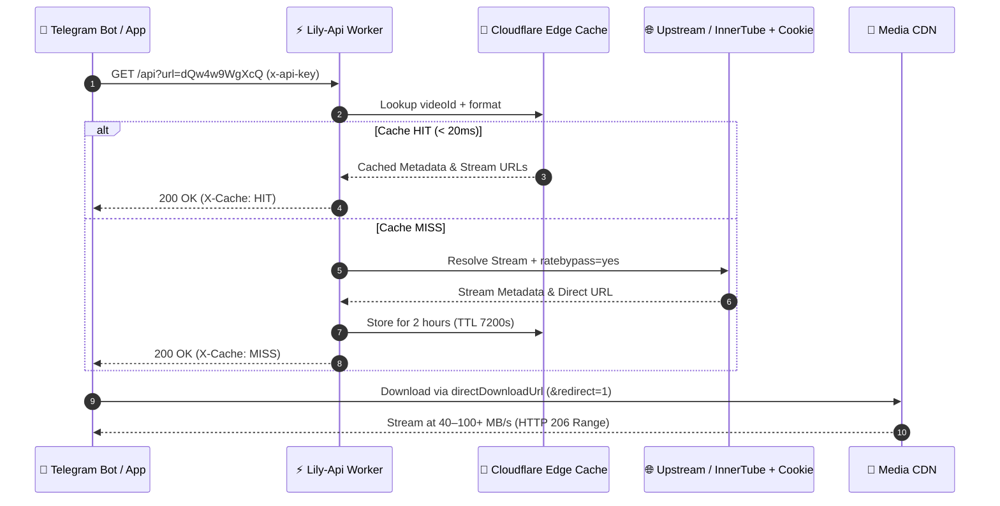

<div align="center">

<!-- Animated Gradient Wave Hero Banner (Self-Hosted SVG) -->
<a href="https://t.me/advaydev">
  
</a>

<!-- Animated Typing Tagline -->
<a href="https://t.me/advaydev">
  
</a>

<br/>

<!-- Colorful Status & Tech Badges -->
<p align="center">
  <a href="https://t.me/advaydev">
    
  </a>
  
  
  
  
  
</p>

<!-- One-Click Cloudflare Deploy Button -->
<p align="center">
  <a href="https://deploy.workers.cloudflare.com/?url=https://github.com/nishkarshk212/Lily-Api">
    
  </a>
</p>

<!-- Interactive Quick-Jump Navigation Pills -->
<p align="center">
  <a href="#-how-lily-api-works"></a>
  <a href="#-speed--benchmarks"></a>
  <a href="#-quick-deploy-guide"></a>
  <a href="#-lily-api-bot-configuration"></a>
  <a href="#-interactive-api-playground"></a>
  <a href="#-faq--troubleshooting"></a>
  <a href="https://t.me/advaydev"></a>
</p>

</div>

---

> [!IMPORTANT]
> **Keep Your Instance Private:** Replace the example URL (`https://lily-api.example.workers.dev`) and example key (`lily_api_key_example`) with your own deployed endpoint and secret token. Never commit real keys or `cookies.txt` to public repositories.

---

## ✨ Why Choose Lily-Api?

<table>
  <tr>
    <td align="center" width="25%">
      <h3>⚡ &lt;20ms Cache</h3>
      Edge-cached lookups respond almost instantly across 300+ Cloudflare nodes.
    </td>
    <td align="center" width="25%">
      <h3>🚀 100+ MB/s CDN</h3>
      <code>&redirect=1</code> bypasses proxy hops for direct unthrottled Google CDN speeds.
    </td>
    <td align="center" width="25%">
      <h3>🔞 Age Unlock</h3>
      Supports embedded TV/Android clients + encrypted <code>YOUTUBE_COOKIE</code> secrets.
    </td>
    <td align="center" width="25%">
      <h3>🎧 206 Seeking</h3>
      Instant byte-range streaming lets Telegram voice chats start playing in <b>0.2s</b>.
    </td>
  </tr>
</table>

---

## 🧭 How Lily-Api Works



---

## ⚡ Speed & Benchmarks

| Delivery Mode | Avg Transfer Speed | 4 MB Audio (`mp3/m4a`) | 100 MB Video (`mp4`) | Best Use Case |
| :--- | :---: | :---: | :---: | :--- |
| 🚀 **Direct Redirect** (`directDownloadUrl`) | **40 – 100+ MB/s** | `~0.2s` | `~1 – 3s` *(VPS / Fast WiFi)* | Fastest file downloads |
| 🛡️ **Edge Proxied** (`downloads`) | **5 – 10 MB/s** | `~0.6s` | `~12 – 18s` | IP-masked bot streaming |
| ⚡ **Edge Cache HIT** (`X-Cache: HIT`) | **< 20 ms** | Instant URL | Instant URL | Popular / repeated tracks |

---

## 🤖 Lily-Api Bot Configuration

Use **Lily-Api** as your drop-in fallback resolver in any Telegram Music Bot (e.g., **VivaanXmusic**, **AnonXMusic**, **YukkiMusic**):

```env
# Example Lily-Api configuration (replace with your own deployed URL & key)
WORKER_FALLBACK_API_URL="https://lily-api.example.workers.dev"
WORKER_FALLBACK_API_KEY="lily_api_key_example"
```

<details>
<summary><b>🧩 Alternative Environment Variable Naming (<code>LILY_API_URL</code> / <code>LILY_API_KEY</code>)</b></summary>

If your custom project uses Lily-specific variable names:

```env
LILY_API_URL="https://lily-api.example.workers.dev"
LILY_API_KEY="lily_api_key_example"
```

</details>

---

## 🚀 Quick Deploy Guide

Choose a deployment option below and click to expand the checklist:

<details open>
<summary><b>🟠 Option 1: Deploy to Cloudflare Workers via CLI (Recommended)</b></summary>

- [x] **1. Clone & install Wrangler**
  ```bash
  git clone https://github.com/nishkarshk212/Lily-Api.git
  cd Lily-Api
  npm install
  npx wrangler login
  ```
- [x] **2. Set your private API key & secrets securely on Cloudflare**
  ```bash
  npx wrangler secret put API_KEY
  # Optional: Unlock 18+ age-restricted videos
  npx wrangler secret put YOUTUBE_COOKIE
  # Optional: Custom upstream relay
  npx wrangler secret put UPSTREAM_BACKEND
  npx wrangler secret put UPSTREAM_API_KEY
  ```
- [x] **3. Deploy to Cloudflare's global edge**
  ```bash
  npx wrangler deploy
  ```

</details>

<details>
<summary><b>🌐 Option 2: Deploy in Browser via Cloudflare Dashboard</b></summary>

1. Open the [Cloudflare Dashboard](https://dash.cloudflare.com/) → **Workers & Pages** → **Create Worker**.
2. Name your worker (e.g. `lily-api`) and click **Deploy** → **Edit Code**.
3. Copy the code from [`worker.js`](worker.js), paste it in, and click **Deploy**.
4. Go to **Settings** → **Variables and Secrets** and add:
   - `API_KEY` → Your chosen secret API key
   - `YOUTUBE_COOKIE` → *(Optional)* Single-line cookie header for age-restricted tracks

</details>

<details>
<summary><b>🐍 Option 3: Self-Host on VPS / Docker (Python FastAPI + yt-dlp)</b></summary>

#### Run Locally
```bash
cp .env.example .env
# Edit .env and set API_KEY=your_secret_key
python3 -m venv venv
source venv/bin/activate
pip install -r requirements.txt
python3 main.py
```

#### Run with Docker
```bash
docker build -t lily-api .
docker run -d -p 8000:8000 -e API_KEY="lily_api_key_example" lily-api
```

</details>

---

## 📡 Interactive API Playground

### Endpoints Overview

| Method | Endpoint | Auth Required | Purpose |
| :---: | :--- | :---: | :--- |
| `GET` | `/` | No | Health & status check |
| `GET` / `POST` | `/api?url=<id_or_url>&format=mp3` | Yes | Extract metadata, direct CDN & proxy stream URLs |
| `GET` | `/api/file/vps/<token>.<ext>` | No | HTTP 206 byte-range stream proxy (add `&redirect=1` for 302 CDN redirect) |

---

### Interactive Code Examples (Multi-Language)

<details open>
<summary><b>💻 cURL (Terminal Quick Test)</b></summary>

```bash
# 1. Health Check
curl -s "https://lily-api.example.workers.dev/"

# 2. Resolve MP3 Audio Stream
curl -s -H "x-api-key: lily_api_key_example" \
  "https://lily-api.example.workers.dev/api?url=https://www.youtube.com/watch?v=dQw4w9WgXcQ&format=mp3"

# 3. Resolve MP4 Video Stream
curl -s -H "x-api-key: lily_api_key_example" \
  "https://lily-api.example.workers.dev/api?url=dQw4w9WgXcQ&format=mp4"
```

</details>

<details>
<summary><b>🐍 Python (Async Bot Integration with <code>httpx</code>)</b></summary>

```python
import httpx

LILY_API_URL = "https://lily-api.example.workers.dev"
LILY_API_KEY = "lily_api_key_example"

async def get_lily_stream(video_url: str, fmt: str = "mp3") -> dict:
    async with httpx.AsyncClient(timeout=20.0) as client:
        resp = await client.get(
            f"{LILY_API_URL}/api",
            params={"url": video_url, "format": fmt},
            headers={"x-api-key": LILY_API_KEY},
        )
        resp.raise_for_status()
        return resp.json()
```

</details>

<details>
<summary><b>🟨 JavaScript / Node.js (<code>fetch</code>)</b></summary>

```javascript
const LILY_API_URL = "https://lily-api.example.workers.dev";
const LILY_API_KEY = "lily_api_key_example";

const res = await fetch(
  `${LILY_API_URL}/api?url=${encodeURIComponent("dQw4w9WgXcQ")}&format=mp3`,
  {
    headers: { "x-api-key": LILY_API_KEY }
  }
);
const data = await res.json();
console.log(data.title, data.directDownloadUrl);
```

</details>

<details>
<summary><b>📦 Sample Success & Error Responses</b></summary>

#### ✅ `200 OK` Success Payload
```json
{
  "success": true,
  "title": "Sample Track Title",
  "fileSize": 3449447,
  "fileSizeText": "3.29 MB",
  "format": "mp3",
  "fullFormat": "mp3",
  "videoId": "dQw4w9WgXcQ",
  "videoUrl": "https://www.youtube.com/watch?v=dQw4w9WgXcQ",
  "downloads": "https://lily-api.example.workers.dev/api/file/vps/<stream_token>.m4a?videoId=dQw4w9WgXcQ",
  "directDownloadUrl": "https://lily-api.example.workers.dev/api/file/vps/<stream_token>.m4a?videoId=dQw4w9WgXcQ&redirect=1",
  "directStreamUrl": "https://cdn-edge/videoplayback?...&ratebypass=yes",
  "mimeType": "audio/mp4",
  "fileExtension": "m4a",
  "audioIncluded": true,
  "videoIncluded": false,
  "provider": "vps"
}
```

#### ❌ Error Codes Explorer
| Status | Error `code` | Meaning |
| :---: | :--- | :--- |
| `401` | `authentication_required` | Missing or incorrect `x-api-key` / `Authorization: Bearer` / `api_key` |
| `400` | `invalid_input` | Missing `url` parameter or invalid YouTube URL / Video ID |
| `400` | `invalid_format` | `format` must be either `mp3` or `mp4` |
| `404` | `not_found` | Invalid route requested |
| `500` / `502` | `extraction_failed` / `upstream_timeout` | Upstream provider timed out or stream unavailable |

</details>

<details>
<summary><b>🧪 Run Automated Test Suite</b></summary>

Verify all 5 API checks (health, auth rejection, format validation, stream extraction, and HTTP 206 byte-range playback):

```bash
python3 test_api.py "https://lily-api.example.workers.dev" "lily_api_key_example"
```

</details>

---

## ❓ FAQ & Troubleshooting

<details>
<summary><b>🔞 How do I unlock 18+ age-restricted videos?</b></summary>

- **Cloudflare Worker:** Export your YouTube cookies, filter the core session tokens, and store them as a Worker secret:
  ```bash
  npx wrangler secret put YOUTUBE_COOKIE
  ```
- **Python FastAPI:** Place your Netscape `cookies.txt` file in the root directory (it is already ignored in [`.gitignore`](.gitignore)). [`main.py`](main.py) automatically passes it to `yt-dlp`.

</details>

<details>
<summary><b>⚡ How do I get maximum download speed (40–100+ MB/s)?</b></summary>

Use the **`directDownloadUrl`** field (which appends `&redirect=1`) or fetch **`directStreamUrl`** directly. This issues a `302` redirect straight to Google's CDN with `ratebypass=yes`, avoiding proxy overhead.

</details>

<details>
<summary><b>🔐 How do I rotate or change my Lily-Api key?</b></summary>

Run `npx wrangler secret put API_KEY` (or update `API_KEY` in Cloudflare Dashboard → **Settings** → **Variables and Secrets**), then update `WORKER_FALLBACK_API_KEY` in your bot's `.env`.

</details>

---

## 👨‍💻 Owner & Support

<div align="center">

Have questions, custom feature requests, or need setup help? Message the owner directly on Telegram!

<a href="https://t.me/advaydev">
  
</a>

<br/><br/>

<b>🔗 Direct Link:</b> <a href="https://t.me/advaydev">https://t.me/advaydev</a>

<br/>

<a href="https://t.me/advaydev">
  
</a>

</div>
